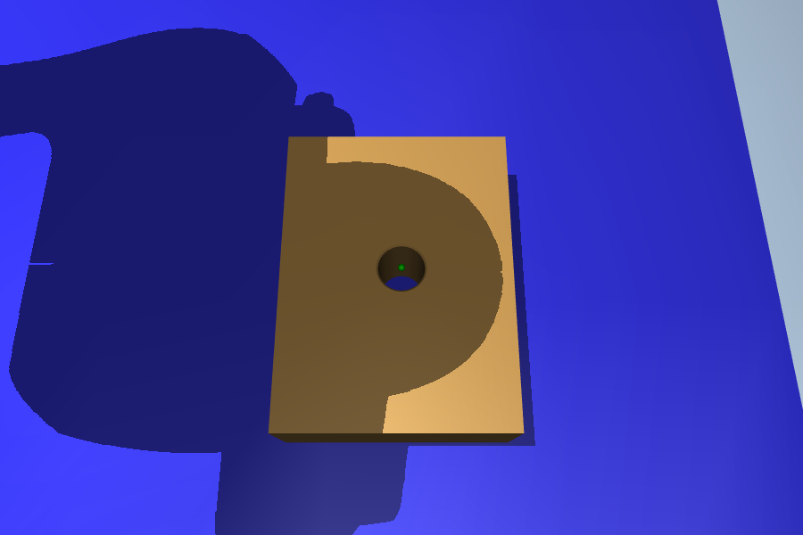

# Team Kilo: Blind Proprioceptive Peg Insertion

16-662 Robot Autonomy, Fall 2026 group project.

A Franka arm picks up a peg from a known holder, finds a taped-down box by
touching it with the peg, and inserts the peg into the box's hole. It uses only
joint sensing (joint positions, velocities and estimated external torques
`tau_ext`): no camera, no wrist force-torque sensor.

- **Phase 1, localization by touch:** sideways approach-until-contact probes
  with the side of the peg's cylindrical shaft and a particle filter for the box
  centre, then a search of the disc of radius `R` around the centre for the hole
  (hole-search strategy still to be decided).
- **Phase 2, RL insertion:** a PPO policy trained in MuJoCo that corrects a
  scripted spiral search, starting from Phase 1's estimate.

The full plan is in [`proposal/proposal.pdf`](proposal/proposal.pdf)
(source: [`proposal/proposal.tex`](proposal/proposal.tex)).

## Key dates

| Date | Milestone |
| --- | --- |
| Nov 23 | Work starts (day 1) |
| Nov 29 | Phase 1 error measured on the real robot; feeds Phase 2 training |
| Nov 30 / Dec 2 | Progress presentation (about 8 min) |
| Dec 6 | End-to-end trials done |
| Dec 11 | Final report (2–3 pages, IEEE two-column) and 1–3 min video due |

## Repository layout

```
kilo/
  localization/   Phase 1: contact detection, box filter, hole-search filter
  insertion/      Phase 2: spiral baseline, MuJoCo env, PPO training
  sim/            MuJoCo scene construction (Panda + peg + box)
  robot/          Real-robot interface (wraps the course control stack)
configs/          Shared parameters (hole radius R, clearance, thresholds)
artifacts/        Published policy checkpoint, config and evaluation summary
scripts/          Training, evaluation, replay and localization entry points
tests/            Unit and MuJoCo integration tests
proposal/         LaTeX proposal; grows into the final report
```

Status of each module:

| Module | Status | Owner |
| --- | --- | --- |
| `localization/probenav.py`, `localization/search.py` | Tactile navigation and search simulation | Phase 1 |
| `localization/archive/` | Earlier contact and particle-filter implementations | Phase 1 |
| `insertion/spiral.py` | Working: Archimedean spiral waypoints | Phase 2 |
| `insertion/env.py` | Gymnasium insertion environment with torque-history observations and bounded spiral residuals | Phase 2 |
| `sim/scene.py`, `sim/geometry.py` | Working: Panda + table + shelves, peg, base with hole | Phase 2 |
| `sim/control.py` | Working: IK and gravity-compensated joint PD (placeholder for impedance control) | Phase 2 |
| `robot/` | Real-robot probing: shared guarded probe; backends for frankapy (default, untested on hardware), panda-py (experimental) and MuJoCo (tested) | Phase 1 |
| `localization/touch_localizer.py`, `localization/fit.py` | Phase 1 search + box fit + face-normal verification, for any backend | Phase 1 |
| `scripts/real/phase1.py` | Real-robot Phase 1 experiments (check, table, noise, touch, groundtruth, localize, refit). Lab guide: [`docs/real_robot.md`](docs/real_robot.md) | Phase 1 |

## Setup

Python 3.10 or newer.

```bash
python -m venv .venv
source .venv/bin/activate        # Windows: .venv\Scripts\activate
python -m pip install -r requirements.txt
python -m pytest tests
```

## Simulation

Run the tactile localization demo from the repository root:

```bash
python scripts/localize.py
python scripts/localize.py --headless
python scripts/localize.py --headless --box 0.52 0.02 0.30
```

The arm starts at the first search corner, sweeps until contact, then probes
from three more directions. It prints the plate center in world XY meters and
the orientation of its local x axis in degrees modulo 180. The optional box
pose sets the simulated center in meters and yaw in radians. Keep the plate
and enough clearance for the probe inside the search rectangle.


`kilo/sim/scene.py` builds the MuJoCo scene from the course's Lab 3 model
(torque-controlled Panda, table and shelves, copied into
`kilo/sim/assets/franka/`) plus:

- **Base:** 126.7 × 169 × 50.8 mm, fixed to the table, with the 25.4 mm
  chamfered through-hole. MuJoCo collides meshes as convex hulls, so the block
  is split into 48 convex wedges around the hole (`sim/geometry.py`); the
  simulated hole is never smaller than the CAD hole. Site `hole_top`.
- **Peg:** 25 mm square top (box) and chamfered 25 mm shaft (convex mesh), fixed
  in the gripper (`peg_mode="hand"`) or loose (`"free"`). Site `peg_tip`.

All sizes come from `configs/default.yaml`, so changing the CAD numbers there
changes the scene.

```bash
python scripts/view_scene.py                 # interactive viewer, peg above the hole
python scripts/view_scene.py --mode free     # loose peg dropped into the hole
python scripts/view_scene.py --box 0.45 0.05 0.3 --render out.png
```

```python
from kilo.sim.scene import build_scene
model = build_scene(peg_mode="hand", box_xy=(0.5, 0.0), box_yaw=0.0, hole_offset=(0.003, 0.003))
```

Checked by `tests/test_scene.py`: an aligned loose peg drops the full 38.1 mm
and rests on its square top; the robot holds the peg to within 0.01 mm and
inserts it when aligned, and jams when 2 mm off (the case Phase 2 is for).

| Peg over the hole | Base from above |
| --- | --- |
|  |  |

## PPO insertion training

Start v4 **fresh** from the repository root. The earlier checkpoints use a
different observation space and controller and cannot be resumed into v4:

```bash
.venv/bin/python scripts/train_insertion.py \
  --envs 8 --timesteps 2000000 --output-dir runs/insertion_v4
```

The trained v4 policy and its exact configuration are included in
`artifacts/insertion_v4/`. The bundle contains one best checkpoint (~2.2 MB),
`config.yaml`, the training version manifest and a compact comparison summary.
Intermediate checkpoints, logs, the venv and generated plots remain ignored.
No training or model download is needed to replay it.

### Watch the included model

On macOS, use the wrapper to handle project paths containing spaces:

```bash
sh scripts/watch_insertion.sh --seed 40000 --episodes 3
```

On Linux, use `.venv/bin/python scripts/watch_insertion.py` with the same flags.
Each seed replays the baseline first, then RL with identical box placement,
estimate error and grasp perturbation. The window labels the controller and
insertion depth; the terminal prints completion time and force. Close the
window to stop. Use `--mode policy`, `--mode baseline`, or `--speed 0.5` for
slow motion. To view a new local training run, pass `--run-dir runs/insertion_v4`.
For a non-graphical smoke check, use `--headless --episodes 1`.

### Measured performance

The selected checkpoint is from 2,000,000 training steps. On 50 paired unseen
starts (seeds 40000–40049), using deterministic actions:

| Metric | Scripted baseline | Script + RL |
| --- | ---: | ---: |
| Success | 50/50 | 50/50 |
| Mean insertion time | 16.40 s | 14.09 s |
| Mean episode peak contact load | 28.24 N | 28.60 N |
| Maximum contact load | 46.99 N | 58.73 N |

RL was faster on 36/50 starts: mean saving 2.31 s (14.1%), paired bootstrap
95% interval 1.09–3.60 s. These trials support a simulation speed improvement,
not improved force behavior or real-world reliability. The baseline already
solves this test set; RL learns bounded corrections, not the entire search.
See [`comparison.json`](artifacts/insertion_v4/comparison.json).

Reproduce the comparison without training (outputs stay local under `runs/`):

```bash
.venv/bin/python scripts/evaluate_insertion.py \
  --model artifacts/insertion_v4/best_model.zip --episodes 50 --seed 40000 \
  --output runs/insertion_v4/test_policy.json
.venv/bin/python scripts/evaluate_insertion.py \
  --config artifacts/insertion_v4/config.yaml --episodes 50 --seed 40000 \
  --output runs/insertion_v4/test_baseline.json
.venv/bin/python scripts/compare_insertion.py --run-dir runs/insertion_v4
```

This produces `comparison.json` and `comparison.png` alongside the per-trial
results. Published software versions are recorded in the bundle's
`manifest.json`; results may change with physics-library versions. The model
was trained with Python 3.10, MuJoCo 3.17.0, SB3 2.9.2 and Torch 2.14.1.

### Environment and training details

- The reference first touches down, then searches with limited downward target
  displacement. It freezes lateral search on entry and uses compliant
  roll/pitch alignment while seating. The policy still has only three position
  actions, as in the proposal. Search stiffness is 600 N/m laterally, insertion
  stiffness 150 N/m, and roll/pitch stiffness 2 Nm/rad.
- Actions are corrections of at most ±1 mm in x/y and ±0.5 mm in z, with a
  5 mm/s slew limit. The initial deterministic policy produces zero correction.
- The actor receives **30 frames × 42 features** (0.6 s at 50 Hz): q, dq,
  estimated external joint torques, nominal tool pose/twist, estimated hole
  displacement, previous action, target tracking error, and reference state.
  The actual randomized peg pose is not supplied to the actor or controller.
- An asymmetric critic additionally gets true relative position, peg axis,
  contact load and remaining time during training. The temporal encoder keeps
  time order and includes the current frame. Tests verify that changing the
  privileged inputs cannot change the actor's output.
- Training and validation both use the full ±5 mm error distribution. Each
  episode is capped at **3,000 steps / 60 seconds**. PPO uses gamma 0.999,
  learning rate 1e-4, 512 steps per worker, batches of 256 and five update epochs.
- Success requires at least **37.1 mm insertion**, with the tip and shaft axis
  at the hole opening both within **0.3 mm** of the true center, sustained for
  **0.1 s**. Success cannot come from the estimated hole position alone.

Rewards are logged separately in each worker's monitor file:

| Term | Definition |
| --- | --- |
| Shaping | `gamma * Phi(next) - Phi(now)`, with `Phi = 2*exp(-radial_error/3mm) + 4*clipped_depth_fraction`; terminal success has zero potential |
| Time | −0.1 per second, or −0.002 per action; −6 at timeout |
| Excess contact load | −0.02 times the integral of load above 8 N; measured at the physics rate |
| Action changes | −0.01 times mean squared normalized action change, multiplied by the action timestep; no sustained-action magnitude penalty |
| Success | +20 once |

At the start, every 200,000 steps, and at completion, the launcher evaluates
20 fixed validation seeds with deterministic actions. `best_model.zip` is
selected by success rate, then mean successful insertion time. The step-zero
evaluation is the same reference without learned corrections. Checkpoints
are saved every 100,000 steps. The run also saves its configuration, package
versions, source hashes, reward terms, force peaks and PPO diagnostics. An
existing run directory is rejected to avoid mixing results.

Watch progress and evaluate the best model on a separate seed set:

```bash
.venv/bin/python scripts/plot_training.py --watch
.venv/bin/python scripts/evaluate_insertion.py \
  --model runs/insertion_v4/best_model.zip --episodes 100 --seed 40000 \
  --output runs/insertion_v4/heldout_evaluation.json
```

For a matched baseline, omit `--model`, pass the run's `--config`, and use
the same seed/episode count. Evaluation does not train the policy.

Assumptions to replace with real measurements before deployment:

- The box is fixed, the hole vertical, and the nominal tool transform calibrated
  from the reproducible square-top grasp. The simulator rigidly attaches the
  peg to the hand; it does not model slipping or grip compliance.
- Phase 1 supplies estimated hole x/y and top-surface height in the robot frame.
  ±5 mm uniform x/y error is provisional, not measured Phase 1 performance.
  Fixture height has no independent random error; first-touch detection cancels
  tool-length bias for the search-to-insertion transition.
- Grasp translation has 0.5 mm standard deviation per axis, and roll/pitch
  0.5 degrees, clipped at three standard deviations. A 3 mm nominal hover keeps
  these perturbations clear of the surface at reset.
- The nominal dimensions remain 25.0 mm shaft / 25.4 mm hole, with 1 mm
  chamfers. Printing error is not yet randomized. The reference paper's real
  pegs had 0.5–1.5 mm clearance **per side**, versus our 0.2 mm, so its success
  rates are not directly comparable.
- Controller gains, contact friction, torque-estimator bias/noise, latency and
  touch threshold need robot measurements. Current sensing is ideal and the
  default friction is fixed. MuJoCo uses a 1 ms physics step and a 5 ms contact
  time constant; this is a numerical setting, not identified material stiffness.
  Bounded target displacement limits spring preload, not impact force: the
  paired 50-trial policy check had a maximum instantaneous summed normal load of
  58.73 N. These force predictions need calibration.
- Training success uses simulator truth. On the robot, completion must be
  checked from calibrated insertion travel/contact behavior and validated
  against physically seated trials.

The temporal/asymmetric design follows [Blind Precise Assembly](https://arxiv.org/html/2610.23849v1).
The decision to start from a functioning controller and learn small corrections
follows [Residual Reinforcement Learning for Robot Control](https://arxiv.org/abs/1812.03201).
This implementation does not reproduce the reference paper's auxiliary
contact-supervision loss or its large-scale training regime.

## Contact-grasp experiment

`configs/contact_grasp.yaml` enables an experimental physical grasp. The peg
is a free body held by frictional contacts with the existing finger geometry;
there is no hand-to-peg weld during the episode. Finger contacts have finite
compliance and allow translation, rotation and slip under load. This models
contact compliance, not deformable fingertip material, structural finger flex
or printed-part deformation. The published v4 artifact and default config
still use the rigid grasp.

Provisional parameters:

| Parameter | Training range / behavior |
| --- | --- |
| Total closing-force cap | 30–70 N, sampled per episode; the split tendon applies half to each finger |
| Sliding friction coefficient | 0.5–1.2, sampled per episode |
| Finger contact time constant | 5–10 ms, sampled per episode; damping ratio 1 |
| Initial grasp | Same translation/tilt perturbations as v4; holder supports peg for 0.2 s while jaws close, then 0.3 s unsupported settling |
| Grip loss | More than 15 mm tip displacement relative to the settled grasp, or loss of bilateral finger contact for 0.2 s; ends episode with −10 |
| Success | Existing seated-depth/alignment/dwell checks, plus bilateral finger contact |

The [Franka Hand manual](https://download.franka.de/documents/220010_Product%20Manual%20Franka%20Hand_1.0_EN.pdf)
specifies adjustable continuous grasp force of 30–70 N. We use that range as
an order-of-magnitude reference; the simulation's total-tendon-force convention
must be checked against the real command and measured finger loads. Friction
is a provisional uncertainty range, not a measured property of our print.
Contact softness follows [MuJoCo's contact modeling guidance](https://mujoco.readthedocs.io/en/stable/modeling.html#contact-parameters);
it is not a calibrated rubber stiffness. Pickup itself remains outside this
insertion task: the supported initialization creates a closed grasp before
policy control begins.

Finger squeeze is excluded from the fixture-contact force penalty. Evaluation
and training logs record drop failures and peak grasp displacement. The actor
still receives nominal tool FK and joint sensing, not actual slip or true peg
pose. No rotational action or learned gripper command was added.

Initial matched check on 20 new seeds (50000–50019): the physical-grasp baseline
succeeded 20/20 in 16.58 s on average; the existing rigid-trained v4 policy
succeeded 20/20 in 14.59 s. Maximum grasp-tip displacement during an episode
was 2.32 mm for the baseline and 1.84 mm for the policy. No drops occurred in
this small check; opening the jaws in a regression test does release the peg.
These are transfer checks, not results of retraining on contact grasps.
Published per-trial results: [baseline](artifacts/contact_grasp_transfer/baseline.json),
[existing policy](artifacts/contact_grasp_transfer/old_policy.json), and
[provenance](artifacts/contact_grasp_transfer/metadata.json).

Watch the existing policy with the new physics before training:

```bash
sh scripts/watch_insertion.sh --config configs/contact_grasp.yaml --seed 50000
```

Start a separate **fresh** run:

```bash
.venv/bin/python scripts/train_insertion.py \
  --config configs/contact_grasp.yaml --envs 8 --timesteps 2000000 \
  --output-dir runs/insertion_contact_v1
```

After a checkpoint is saved, replay it with:

```bash
sh scripts/watch_insertion.sh --run-dir runs/insertion_contact_v1 --seed 50000
```

For a matched physical-grasp baseline, use `scripts/evaluate_insertion.py`
with `--config configs/contact_grasp.yaml` and omit `--model`. To test transfer
of the existing rigid-grasp policy, also pass
`--model artifacts/insertion_v4/best_model.zip`. Use identical seeds for both.

## Working together

- Branch per task (`phase1/hole-search`, `phase2/env`), open a pull request,
  get one review before merging to `main`.
- Keep shared numbers (R, hole diameter, clearance, thresholds) in
  `configs/default.yaml`, not hard-coded.
- Robot safety (course rules): never run the robot alone; one person always on
  the emergency stop.

## Building the proposal

```bash
cd proposal
pdflatex proposal.tex && pdflatex proposal.tex
```

Or upload `proposal/proposal.tex` to Overleaf.

## References

- A. Bronars, Y. Park *et al.*, [Blind Precise Assembly](https://younghyopark.me/blind-proprioceptive-assembly/), 2026.
- [mjfit](https://github.com/younghyopark/mjfit): exact convex MuJoCo collision geometry for pegs and holes.
