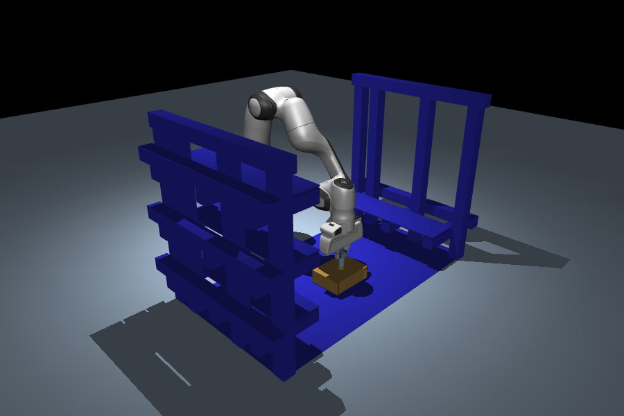
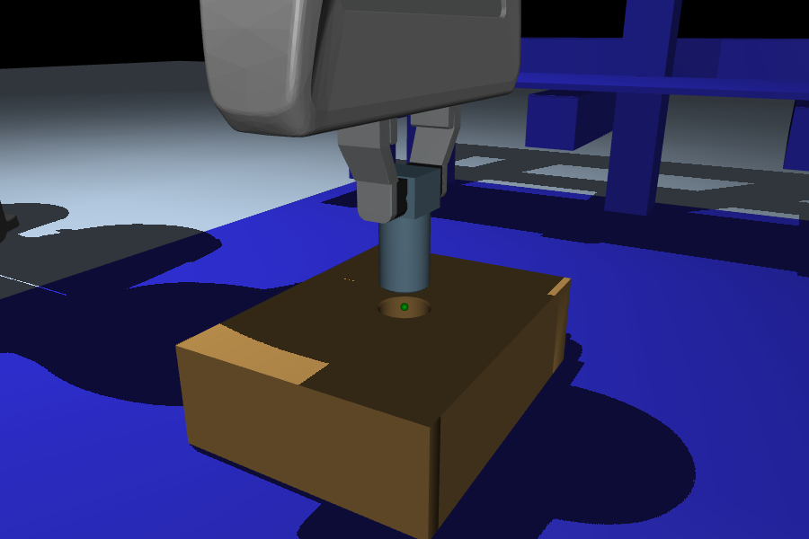

# Team Kilo: Blind Proprioceptive Peg Insertion

16-662 Robot Autonomy, Fall 2026 group project.

A Franka arm picks up a peg from a known holder, finds a taped-down box by
touching it with the peg, and inserts the peg into the box's hole. It uses only
joint sensing (joint positions, velocities and estimated external torques
`tau_ext`): no camera, no wrist force-torque sensor.

- **Phase 1, localization by touch:** sideways approach-until-contact probes
  with the side of the peg's cylindrical shaft and a particle filter for the box
  centre, then a search of the disc of radius `R` around the centre for the hole
  (hole-search strategy still to be decided).
- **Phase 2, RL insertion:** a PPO policy trained in MuJoCo that corrects a
  scripted spiral search, starting from Phase 1's estimate.

The full plan is in [`proposal/proposal.pdf`](proposal/proposal.pdf)
(source: [`proposal/proposal.tex`](proposal/proposal.tex)).

## Key dates

| Date | Milestone |
| --- | --- |
| Nov 23 | Work starts (day 1) |
| Nov 29 | Phase 1 error measured on the real robot; feeds Phase 2 training |
| Nov 30 / Dec 2 | Progress presentation (about 8 min) |
| Dec 6 | End-to-end trials done |
| Dec 11 | Final report (2–3 pages, IEEE two-column) and 1–3 min video due |

## Repository layout

```
kilo/
  localization/   Phase 1: contact detection, box filter, hole-search filter
  insertion/      Phase 2: spiral baseline, MuJoCo env, PPO training
  sim/            MuJoCo scene construction (Panda + peg + box)
  robot/          FrankaPy adapter for Phase 1 hardware localization
configs/          Shared parameters (hole radius R, clearance, thresholds)
tests/            Unit tests for the pure-Python pieces
proposal/         LaTeX proposal; grows into the final report
```

Status of each module:

| Module | Status | Owner |
| --- | --- | --- |
| `localization/contact.py` | Working: debounced threshold detector | Phase 1 |
| `localization/hole_filter.py` | Working disc-prior filter; its press model is a placeholder until the hole strategy is chosen | Phase 1 |
| `localization/box_filter.py` | Stub | Phase 1 |
| `localization/search.py` | Stub: snake-search waypoints over the plate workspace | Phase 1 |
| `insertion/spiral.py` | Working: Archimedean spiral waypoints | Phase 2 |
| `insertion/env.py` | Stub | Phase 2 |
| `sim/scene.py`, `sim/geometry.py` | Working: Panda + table + shelves, peg, base with hole | Phase 2 |
| `sim/control.py` | Working: IK and gravity-compensated joint PD (placeholder for impedance control) | Phase 2 |
| `robot/frankapy_localization.py` | FrankaPy joint-motion adapter for the shared plate search | Phase 1 |

## Setup

Python 3.10 or newer.

```bash
python -m venv .venv
source .venv/bin/activate        # Windows: .venv\Scripts\activate
pip install -r requirements.txt
python -m pytest tests
```

## Simulation

Run the tactile localization demo from the repository root:

```bash
python scripts/localize.py
python scripts/localize.py --headless
python scripts/localize.py --headless --box 0.52 0.02 0.30
```

The arm starts at the first search corner, sweeps until contact, then probes
from three more directions. It prints the plate center in world XY meters and
the orientation of its local x axis in degrees modulo 180. The optional box
pose sets the simulated center in meters and yaw in radians. Keep the plate
and enough clearance for the probe inside the search rectangle.



`kilo/sim/scene.py` builds the MuJoCo scene from the course's Lab 3 model
(torque-controlled Panda, table and shelves, copied into
`kilo/sim/assets/franka/`) plus:

- **Base:** 126.7 × 169 × 50.8 mm, fixed to the table, with the 25.4 mm
  chamfered through-hole. MuJoCo collides meshes as convex hulls, so the block
  is split into 48 convex wedges around the hole (`sim/geometry.py`); the
  simulated hole is never smaller than the CAD hole. Site `hole_top`.
- **Peg:** 25 mm square top (box) and chamfered 25 mm shaft (convex mesh), fixed
  in the gripper (`peg_mode="hand"`) or loose (`"free"`). Site `peg_tip`.

All sizes come from `configs/default.yaml`, so changing the CAD numbers there
changes the scene.

```bash
python scripts/view_scene.py                 # interactive viewer, peg above the hole
python scripts/view_scene.py --mode free     # loose peg dropped into the hole
python scripts/view_scene.py --box 0.45 0.05 0.3 --render out.png
```

```python
from kilo.sim.scene import build_scene
model = build_scene(peg_mode="hand", box_xy=(0.5, 0.0), box_yaw=0.0, hole_offset=(0.003, 0.003))
```

Checked by `tests/test_scene.py`: an aligned loose peg drops the full 38.1 mm
and rests on its square top; the robot holds the peg to within 0.01 mm and
inserts it when aligned, and jams when 2 mm off (the case Phase 2 is for).

| Peg over the hole | Base from above |
| --- | --- |
|  |  |

## Hardware localization

Run from the project root in the course ROS and FrankaPy environment, with the
peg already grasped. Both entry points use the same snake, four contacts,
and plate fit. The search rectangle in the robot base frame spans
0.32 to 0.61 m in x and −0.18 to +0.18 m in y.

```bash
python scripts/localize_live.py --table-z 0.0072
python scripts/localize_live.py --table-z 0.0072 --execute
```

The first command prints the sweep size without connecting. The second moves
the arm. The example uses the measured tabletop height on the lab station.
Without `--table-z`, the runner uses the Lab 2 model's tabletop height.
Keep the arm stationary with the peg grasped for the initial five seconds.
The runner samples Fx, Fy, and Fz at a target 20 Hz, saves the raw readings
to `force-zero.csv` in the run directory, and subtracts their per-axis means before motion.
The sweep starts after the recording obtains at least 10 samples per second
on average.

The live adapter uses the MuJoCo peg-tip model to solve joint waypoints along
each sweep leg or crossing. It uses Lab 2's 0.01 rad joint tracking tolerance,
0.5 mm and 0.003 rad IK tolerances, 0.30 rad/s² joint acceleration, and
0.5 s minimum skill duration. The joint speed limit is 0.15 rad/s for joints
1–6 and 0.225 rad/s for joint 7, which rotates about tool Z. Travel waits for
each skill.
Probes track slow drift in FrankaPy's horizontal wrench and stop immediately
above 5 N over that baseline. The robot records the first hit, waits for fresh
stationary feedback, then lifts vertically from the measured tip position.
Recoverable FrankaPy communication or joint-generator errors and short
waypoints can retry up to twice from the measured joints after the controller
returns to idle. Collision and reflex reports end the run. The simulation uses
a 5 N horizontal contact threshold. The 20 N force cutoff stays separate.
After estimating the plate center and yaw modulo 180°, the live runner measures
the top surface height and starts the hole particle filter. The first two
candidates come from the CAD offset and the two possible plate orientations.
The filter chooses subsequent candidates using the measured presses. During
each descent, a 5 N vertical force residual ends the press, and travel of at
least 2 mm below the measured surface counts as a drop. The nominal radial
capture clearance is 0.2 mm. Print and calibration error can make drops hard to
find, so the run can end with the hole unconfirmed.

Each live run saves the plate fit, forces, peg-tip paths, and hole search under
`runs/real`. Pass `--out` to save to a different folder. Generate the restored
GitHub localization charts and hole plot from the recorded data with:

```bash
python scripts/real/view_localization.py --latest
```

## Working together

- Branch per task (`phase1/hole-search`, `phase2/env`), open a pull request,
  get one review before merging to `main`.
- Keep shared numbers (R, hole diameter, clearance, thresholds) in
  `configs/default.yaml`, not hard-coded.
- Robot safety (course rules): never run the robot alone; one person always on
  the emergency stop.

## Building the proposal

```bash
cd proposal
pdflatex proposal.tex && pdflatex proposal.tex
```

Or upload `proposal/proposal.tex` to Overleaf.

## References

- A. Bronars, Y. Park *et al.*, [Blind Precise Assembly](https://younghyopark.me/blind-proprioceptive-assembly/), 2026.
- [mjfit](https://github.com/younghyopark/mjfit): exact convex MuJoCo collision geometry for pegs and holes.
